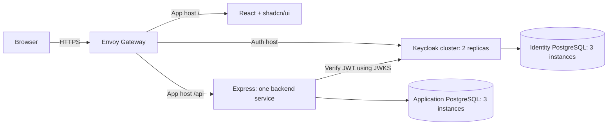

# Acme Platform

An Nx monorepo with a React + TypeScript + Vite frontend using **shadcn/ui**, one modular TypeScript + Express backend using **TypeORM**, **Envoy Gateway**, self-hosted **Keycloak**, in-cluster **PostgreSQL**, **BullMQ** workers, separate **Redis** queue/cache instances, and **Kafka**.

The backend is a modular monolith: feature modules have explicit boundaries but run in one service and deploy as one image. Gateway, identity, data, and observability infrastructure have separate releases. Organization memberships and PostgreSQL row-level security isolate tenant data. OpenTelemetry, Pino, Prometheus, Loki, Tempo and Grafana provide correlated telemetry.



Envoy terminates TLS and routes traffic. nginx only serves the frontend's compiled static files and SPA fallback. The previous Kubernetes Ingress resources have been removed.

## Local development

Use Node 22.13+ in the 22.x line and pnpm 11.25.0, plus Docker Compose.

```sh
nvm use
corepack enable
pnpm install --frozen-lockfile
cp .env.example .env
# Fill in KEYCLOAK_ADMIN_PASSWORD, POSTGRES_PASSWORD, POSTGRES_RUNTIME_PASSWORD,
# QUEUE_REDIS_PASSWORD and CACHE_REDIS_PASSWORD.
docker compose up -d
pnpm db:setup
pnpm db:migrate
docker compose -f compose.async.yaml up -d --wait
pnpm kafka:setup
PORT=3100 pnpm dev
```

Open <http://localhost:4200>. Vite proxies `/api` to the backend; `PORT` changes both the backend and proxy target. `API_PROXY_TARGET` can override the proxy independently. PostgreSQL is exposed only on loopback at port 5433 and Keycloak at <http://localhost:8081>.

In Keycloak, sign in to the admin console with username `admin` and the bootstrap password from `.env`. Select the imported `platform` realm, create a user, and set their password. Then use **Sign in to your workspace** in the frontend. The SPA uses a public `platform-web` client, authorization code flow with PKCE, and in-memory tokens. There is no client secret in the browser and password grants are disabled for the SPA.

Local Compose data persists in named volumes. Realm import only creates a missing realm; editing the JSON does not update an existing realm. The Compose Keycloak `start-dev` setup is for local development; Kubernetes uses the official Operator and a separate PostgreSQL cluster.

## Workspace and boundaries

```text
apps/frontend/
  components.json             shadcn CLI configuration
  src/components/ui/          Owned shadcn component source
  src/styles.css              Tailwind v4 and semantic theme tokens
  src/auth/                   Keycloak adapter and session context
  public/config.json          Local auth configuration; overridden by Helm
apps/backend/
  src/main.ts                 Composition root and graceful shutdown
  src/app.ts                  HTTP middleware and module routing
  src/auth.ts                 JWT signature/issuer/audience/expiry validation
  src/infrastructure/         TypeORM schema, tenant transactions, PostgreSQL pool and migrations
  src/modules/accounts/       Account domain: entry point, service, repository
  src/modules/platform/       Platform API module
  src/modules/organizations/  Organization memberships and tenant notes
  src/observability/           OTel SDK, HTTP instrumentation and central Pino logger
  migrations/                 Native TypeORM up/down migrations
libs/contracts/               Public API types and paths
deploy/helm/                 edge, identity, data, platform, observability charts
deploy/{edge,identity,data,observability}/ Environment values and deployment RBAC
```

Feature modules expose an `index.ts` entry point. Other modules import that public API; services own business logic, and repositories own parameterized SQL. The `accounts` schema belongs to the accounts module. Shared contracts contain transport types rather than database entities. ESLint restricts imports into another module's implementation.

The backend owns its PostgreSQL database. It never reads Keycloak's tables. Keycloak owns a different PostgreSQL cluster, credentials, and namespace. This structure leaves room to extract a feature into another service later, while keeping today's application to one backend deployment.

| Endpoint | Authentication | Behavior |
| --- | --- | --- |
| `GET /health/live` | Public | Process health |
| `GET /health/ready` | Public | Database connectivity and shutdown readiness |
| `GET /api/greeting` | Bearer token | Protected sample endpoint |
| `GET /api/me` | Bearer token | Lazily provisions and returns the current account from PostgreSQL |

Accounts are keyed by verified issuer and subject. Callers cannot select another account using query parameters. The API requires RS256 access tokens with the `platform-api` audience; ID tokens, wrong issuers, invalid signatures, and expired tokens are rejected. Organization roles and database RLS protect tenant endpoints; add domain-specific permissions as features are introduced.

## shadcn/ui

Button, Card, Badge, Alert, and Separator components are installed and used by the page. Add components with:

```sh
pnpm exec shadcn add dialog --cwd apps/frontend
```

Edit semantic colors and radii in `apps/frontend/src/styles.css`. Components live in the frontend workspace because there is currently one UI application. Both TypeScript and Vite resolve the `@/` alias.

## Checks

```sh
pnpm check                    # Nx lint, types, tests, production builds
pnpm exec nx run backend:test-integration # Uses PostgreSQL; see environment below
pnpm helm:check               # Requires Helm 3.19+ on PATH
pnpm graph
```

For local database integration tests, supply the connection settings from `.env`, for example by exporting `PGHOST=localhost`, `PGPORT=5433`, `PGUSER=platform`, `PGDATABASE=platform`, and `PGPASSWORD`. The suite creates a uniquely named disposable database, verifies migrations and authenticated account isolation, then deletes its generated database and login roles. It requires a disposable test administrator allowed to create databases and roles. CI supplies a disposable PostgreSQL service and runs this target without Nx caching.

`pnpm check` does not require a database or Keycloak instance. Its auth tests use signed tokens with test keys. Integration tests verify real SQL, repeatable migrations, rollback of failed migrations, and native down/up migrations.

## CI and releases

PRs run affected Nx checks and build affected containers without publishing. Main publishes affected images to GHCR and carries forward unchanged image digests from the last successful staging release. A missing or expired baseline rebuilds both apps. Shared contract or dependency changes affect both applications; infrastructure changes are validated without rebuilding application images unnecessarily.

Each `release-bundle` contains the complete image manifest, packaged application chart, and staging/production values. Deployments use digests rather than mutable tags. Frontend OIDC settings come from a mounted `config.json`, so the same image promotes between environments.

The application chart runs migrations from the **same backend image** as a pre-install/pre-upgrade Job. Migrations are serialized by a PostgreSQL advisory lock and recorded in TypeORM migration history. App rollout and smoke-test failures roll back application manifests; committed database migrations remain. Use backward-compatible expand/contract migrations so old and new app replicas can overlap safely.

After a successful staging run:

```sh
gh workflow run promote.yml --ref main -f run_id=123456789
```

Production verifies that run and promotes its exact bundle through the production environment gate. Configure required reviewers in GitHub; a YAML environment reference alone does not create an approval policy. Artifacts are retained for 90 days; retain referenced GHCR digests and archive bundles longer if required by your recovery policy.

Gateway, identity, and database changes use separate manual workflows. Bootstrap these before enabling app deployment. See [deployment and operations](docs/deployment.md) for the complete order, namespaces, secrets, DNS/TLS, backup requirements, and recovery boundaries.

## References

- [shadcn/ui with Vite](https://ui.shadcn.com/docs/installation/vite)
- [Keycloak JavaScript adapter](https://www.keycloak.org/securing-apps/javascript-adapter)
- [Keycloak Operator](https://www.keycloak.org/operator/installation)
- [CloudNativePG](https://cloudnative-pg.io/docs/1.28/)
- [Envoy Gateway](https://gateway.envoyproxy.io/docs/tasks/quickstart/)
- [Nx affected projects](https://nx.dev/docs/features/ci-features/affected)

## Organizations and observability

Sign in to create an organization, switch teams, manage members and add shared notes. See [multitenancy](docs/multitenancy.md) for the role matrix, API and database boundaries.

Set `GRAFANA_ADMIN_PASSWORD` in `.env`, then run `docker compose -f compose.observability.yaml up -d`. Grafana runs at <http://localhost:3001> with provisioned dashboards and Prometheus/Loki/Tempo data sources. See [observability](docs/observability.md) for deployment, query examples, retention, alerting and availability limits. Telemetry is for platform operators, separate from application tenant access.

## Backend database access

Application queries use **TypeORM** with PostgreSQL. Typed entity schemas live in `apps/backend/src/infrastructure/schema.ts`; tenant queries use the transaction's `EntityManager` supplied by `withIdentity`. Schema synchronization and query/parameter logging are disabled.

Native TypeORM migrations in `apps/backend/migrations` implement both `up` and `down`. Use `pnpm db:migrate`, `pnpm db:rollback` (one migration), and `pnpm db:status`. See [database migrations](docs/migrations.md) for generation, rollback behavior and deployment compatibility.

BullMQ workers, separate queue/cache Redis instances, Kafka, and the PostgreSQL outbox are included. See [async jobs and events](docs/async.md) for local setup, job endpoints, tenancy guarantees, operational limits and the messaging Helm release.
