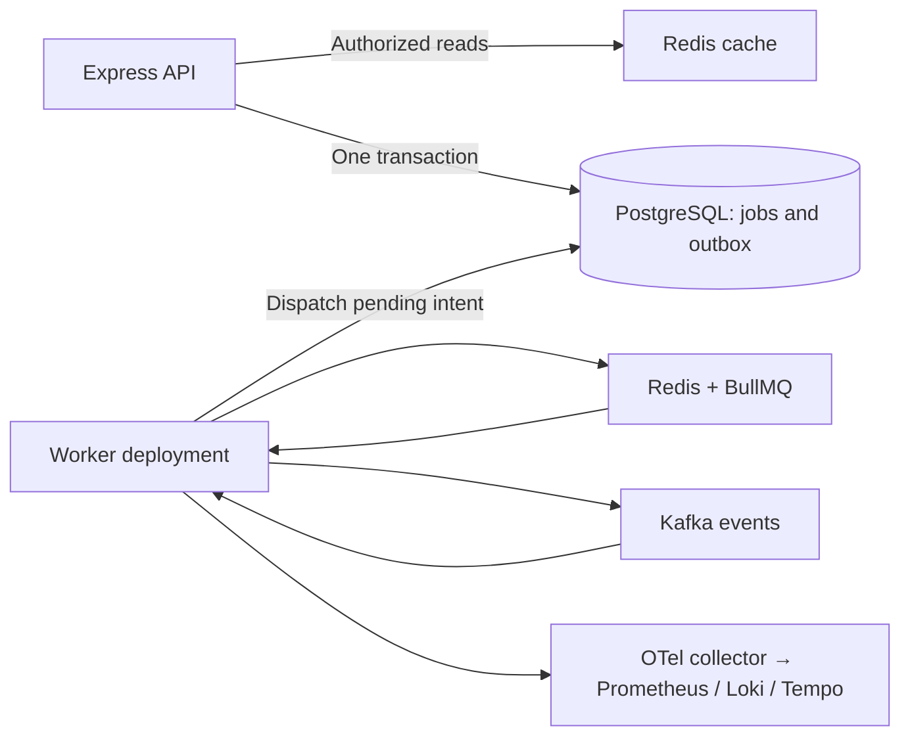

# Background jobs, caching and events

The API accepts work, PostgreSQL records durable intent, and an independently deployed worker executes it. Redis/Kafka are infrastructure services, not sidecars. Existing central OTel collectors and node log agents already cover telemetry; no service mesh or extra sidecar is enabled.



The backend image contains `main.cjs`, `worker.cjs` and `migrate.cjs`. One Nx affected build and GHCR digest covers all three entrypoints. The worker has its own replicas, probes, resources and graceful shutdown. Production starts with two workers; each processes two jobs concurrently. Kafka consumers share `platform-worker-v1`, so one worker in that group handles each partition. Future independent subscribers use their own consumer group and narrowly scoped KafkaUser credentials.

## Local development

Start the regular PostgreSQL/Keycloak Compose stack first. Set unique development `QUEUE_REDIS_PASSWORD` and `CACHE_REDIS_PASSWORD` in `.env`; optionally set a distinct `POSTGRES_WORKER_PASSWORD` (local setup otherwise reuses the runtime password). The checked-in example sets the host/ports and `ASYNC_ENABLED=true`.

```sh
pnpm db:setup
pnpm db:migrate
docker compose -f compose.async.yaml up -d --wait
pnpm kafka:setup
PORT=3100 pnpm dev

# Or launch only the worker:
# pnpm dev:worker
```

`pnpm dev` starts frontend, API and worker together. Queue Redis listens on loopback 6390, cache on 6391, Kafka on 9092. Kafka's plaintext listener is local development only; Kubernetes uses internal TLS with SCRAM and topic/group ACLs. Keep local worker `PGUSER=platform_worker` and its password separate from the API runtime role. `PORT=3002` is the worker's health server.

## API and execution

Register using authenticated `GET /api/me`, create/select an organization, then call:

```http
POST /api/organization/jobs/notes-report
Authorization: Bearer <Keycloak access token>
X-Tenant-ID: <organization UUID>
Idempotency-Key: <new UUID>
Content-Type: application/json

{"delaySeconds": 0}
```

The response is 202 once the job and outbox commit, even if the brokers are unavailable. Delay is optional, from zero to 30 days. Repeating the same UUID and delay returns the existing request; conflicting reuse is 409. `GET /api/organization/jobs` lists the requesting user's jobs for the selected organization. The sample job returns a note count and generation time in PostgreSQL. It is a concrete template for adding supported handlers, not an arbitrary code execution API.

Every execution rechecks the stored requester's current organization membership. Revoked work becomes `cancelled`, with no result. Queue data contains an outbox reference, not a JWT or tenant content. Idempotent execution locks the job record and preserves an already-completed result. Five attempts use exponential backoff; terminal failures retain a safe failure code, while queue failures remain inspectable for seven days. To retry a terminal application job, submit a new idempotency key after fixing the cause; completed jobs keep their original result.

“Long term” supports delayed execution and durable intent. For long-running business work, split processing into bounded, checkpointed steps and make each side effect idempotent. Do not hold the sample PostgreSQL transaction open for hours or block Node's event loop with CPU-heavy work. BullMQ renews locks while the processor runs; a crashed worker's stalled jobs can be recovered. Shutdown drains active work up to the pod deadline, after which another worker may retry it.

## Delivery and caching semantics

Note creation and `note.created.v1` outbox insertion share one PostgreSQL transaction. The dispatcher uses row locks and `SKIP LOCKED`, broker acknowledgements, then records delivery. Crashes between acknowledgement and commit can produce duplicates: delivery is **at least once**. Kafka event UUIDs and the subscriber's unique inbox record deduplicate the included receipt handler. Add future database side effects and receipt insertion in the same transaction; remote side effects need their own idempotency keys. Kafka partition keys are organization UUIDs, but concurrent outbox dispatchers do not guarantee original transaction ordering.

Malformed or unsupported events are copied to `platform.events.dlq.v1` before their source offsets advance. Event and DLQ topics retain seven days. The example consumer records receipt metadata; it does not imply a second business service. Queue-loss reconciliation scans pending PostgreSQL jobs in batches every minute and redelivers missing queue entries. PostgreSQL job status/results remain authoritative.

Cache Redis is separate, bounded and uses `allkeys-lru`. Queue Redis uses a persistent volume, AOF with `appendfsync always`, and `noeviction`. A full queue fails writes and leaves intent in the PostgreSQL outbox for retry. Cache failures fall back to SQL. Cache reads follow live membership checks and use organization/version keys with a 30-second TTL. A PostgreSQL trigger increments the version after note changes, preventing an old in-flight read from refilling the current key.

## Kubernetes and operations

Deploy data (including `platform_worker`) and messaging before the application. The separate messaging workflow deploys Redis and a three-node Strimzi Kafka KRaft cluster with persistent storage, TLS, SCRAM, six partitions and replication factor three/minimum two in-sync replicas. Kafka nodes require three Kubernetes nodes. Its operator watches staging and production namespaces; application credentials stay namespace-local. Only workers can reach queue Redis/Kafka; only API pods can reach cache Redis under the generated ingress policies (requires a NetworkPolicy-enforcing CNI).

Redis queue storage is persistent but starts as **one primary**, so it pauses during pod/node/PVC recovery. It is not automatic Redis failover. Cache is disposable. The PostgreSQL outbox protects accepted job intent from queue loss, but external side effects still require idempotency. Size Kafka/Redis disks, memory and retention for the workload; configure backups and test restore alongside PostgreSQL before relying on production recovery objectives. Redis traffic is private, password-authenticated within the namespace; Kafka and PostgreSQL verify TLS.

OTel emits job spans, continued event traces, structured logs, job result counts, outbox deliveries/backlog/oldest age, event outcomes and cache hits/misses/errors. They use bounded metric labels; tenant/job/event IDs appear in traces/logs only. The worker collector route is enabled and node logs exclude its duplicate stdout. Inspect pending outbox age, failed/cancelled job counts and DLQ traffic. Job and inbox history is intentionally retained in PostgreSQL; establish archival retention before high-volume use. Broker-level exporter dashboards are not included in this starter.

Run the disposable integration target using the same environment as `.github/workflows/async-check.yml`: `ASYNC_TEST_DISPOSABLE=true pnpm exec nx run backend:test-async`. It verifies live Redis/Kafka processing, delayed/idempotent jobs, event deduplication, cache invalidation, tenant isolation and membership revocation across a worker restart. Never point that suite at shared production brokers.
