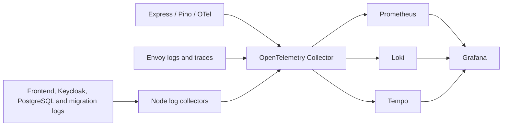

# Observability

The backend exports OpenTelemetry traces, metrics and logs over OTLP/HTTP. Pino produces structured JSON on stdout and sends the same redacted records through the OTel logging SDK. Request logs include a generated request ID, W3C trace/span IDs, route template, response status, duration, and an organization ID only after authorization. Tenant IDs are never metric labels. SQL parameters, note content, cookies, tokens, and query strings are omitted.



HTTP instrumentation is explicit so it works in the bundled backend container. It extracts incoming W3C trace context and records request metrics; database transactions create child spans without logging SQL. Health probes are excluded. Each replica has a separate service instance identity. Production/staging roots sample 10% of traces, with parent-based sampling in the backend. Logs and metrics are not trace-sampled. Browser telemetry is not collected, and OTLP is not exposed to the browser.

## Local use

Set `GRAFANA_ADMIN_PASSWORD` in `.env`, then run:

```sh
docker compose -f compose.observability.yaml up -d
PORT=3100 pnpm dev
```

`.env.example` enables export to `http://localhost:4318`. Leave `OTEL_EXPORTER_OTLP_ENDPOINT` empty to disable local export. Application availability does not depend on the collector being available.

Open Grafana at <http://localhost:3001> using `admin` and your configured password. **Platform / Platform overview** contains request rate, p95 latency, errors, scrape target health, and backend logs. Explore has Prometheus, Loki and Tempo data sources with trace/log links. Prometheus is available on loopback port 9090. Tempo and Loki are reachable through Grafana, without published host ports. Local Compose uses root for collector/Loki/Tempo named-volume initialization; Kubernetes workloads run non-root, except the node log readers.

Example queries:

```promql
sum by (http_route) (rate(http_server_requests_total[5m]))
histogram_quantile(0.95, sum by (le, http_route) (rate(http_server_request_duration_seconds_bucket[5m])))
```

```logql
{service_name="platform-backend"} | json | tenantId="<organization-uuid>"
{service_name="platform-backend"} | json | requestId="<request-uuid>"
{service_name="platform-gateway"}
{service_name="platform-pods", k8s_namespace_name="identity-staging"}
```

This Grafana instance is for trusted platform operators. Application organization membership does **not** authorize Grafana access: operators can query multiple organizations' telemetry. Do not expose these data sources directly to application tenants.

## Kubernetes deployment

Bootstrap creates `observability-staging` and `observability-production` namespaces and deployment RBAC. Create a `grafana-admin` Secret in each namespace using your secret management process, with `username` and `password` keys. Configure `observability-staging` and `observability-production` GitHub environments with `KUBE_CONFIG_B64` using the `observability-deployer` identity. Then run the `observability.yml` workflow. Install observability before enabling the gateway's telemetry references and deploying the application.

```sh
gh workflow run observability.yml --ref main -f environment=staging
kubectl -n observability-staging port-forward service/grafana 3001:3000
```

All services use ClusterIP. NetworkPolicy admits OTLP from the matching backend and Envoy pods, plus communication within the observability namespace. A ReferenceGrant permits the edge namespace's EnvoyProxy to reference the collector. A NetworkPolicy-capable CNI is required. The receiver uses internal plaintext OTLP; use transport encryption if your cluster threat model requires it.

The optional node log DaemonSet reads only platform/identity namespaces for its environment, skips the backend's already-exported logs, and excludes the observability namespace to prevent ingestion loops. It requires hostPath access to `/var/log/pods` and stores read offsets under `/var/lib/otel-platform-<environment>`. It runs as root with capabilities dropped, no privilege escalation and no API token. Set `logAgent.enabled=false` if your provider prohibits hostPath readers, and supply its log forwarding integration instead. Frontend access logs omit URL/query content; Keycloak emits JSON. Application code must continue to omit sensitive fields from message text, since arbitrary free-text secrets cannot be reliably redacted automatically.

## Storage, retention and limits

This initial stack uses **one persistent instance per telemetry component**. It is suitable for getting telemetry working but is not an HA observability cluster. Loki and Tempo use filesystem-backed PVCs; Prometheus uses its local TSDB. Size and back up these volumes, and move Loki/Tempo to object storage with an appropriate deployment topology before requiring resilient production telemetry. Application/Keycloak HA does not imply telemetry HA.

Defaults: Loki logs 7 days, Tempo's default trace retention 14 days, Prometheus 15 days or 16 GB, whichever limit is reached first. Compose limits Prometheus to 2 GB. Edit the committed configs and storage values to match capacity and retention requirements. StatefulSet PVCs survive normal Helm removal; namespace deletion still destroys namespaced resources.

The collector uses a 2 GiB persistent queue volume, batching, memory limits and bounded retries. SDK batches are in memory and can be lost on a crash; saturation or extended outages can drop telemetry. This logger is not a durable compliance audit store.

Prometheus evaluates supplied error-rate, latency and telemetry-target rules. External alert delivery, on-call routing, Kubernetes/node exporters, and full database/Keycloak metrics are not configured. Add those for your operational requirements; the current dashboard covers backend request metrics and telemetry storage health.

Grafana admin credentials initialize the database on first startup. Changing the Kubernetes Secret does not rotate an existing Grafana administrator password; rotate that account through Grafana and update the Secret to keep recovery configuration consistent.

## Verification

The path-filtered `observability-check.yml` workflow starts disposable PostgreSQL and telemetry services, builds the real backend bundle, creates a tenant note using a signed test token, and queries all three signals through Grafana. It verifies request/tenant correlation, a database child span, and omission of note content/query tokens. Container/volume cleanup runs even on failure. Unit tests also verify log redaction and trace propagation.

The Kubernetes charts are linted/rendered in CI and cross-release references checked. Live Kubernetes ingestion, node log mounts and gateway reconciliation still require staging verification on your provider.

References: [OpenTelemetry Node.js](https://opentelemetry.io/docs/languages/js/getting-started/nodejs/), [Loki OTLP ingestion](https://grafana.com/docs/loki/latest/send-data/otel/), [Prometheus OTLP ingestion](https://prometheus.io/docs/guides/opentelemetry/), [Envoy tracing](https://gateway.envoyproxy.io/docs/tasks/observability/proxy-trace/).
